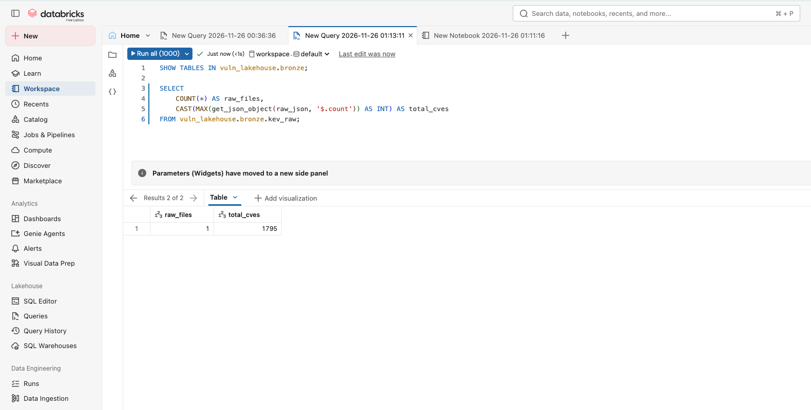
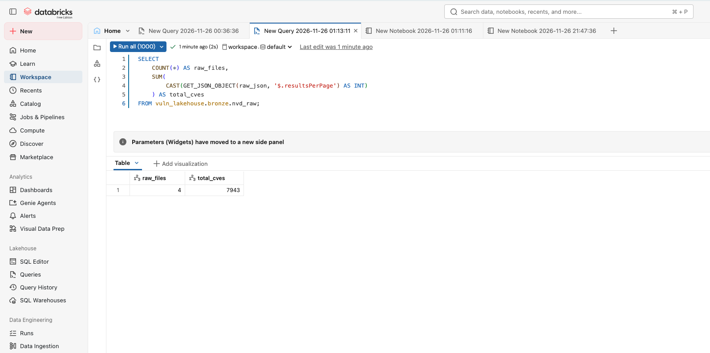
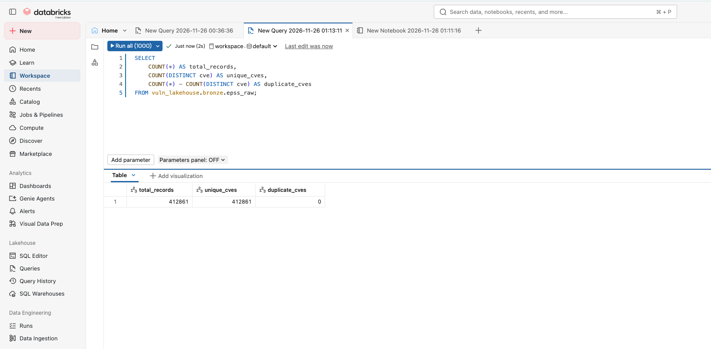

# Bronze Layer

The Bronze layer ingests source vulnerability datasets into Delta Lake, preserving raw payloads and ingestion metadata for downstream transformations.

## CISA Known Exploited Vulnerabilities (KEV)

| Property | Value |
|---|---|
| Source | CISA KEV Catalog |
| Landing Location | `/Volumes/vuln_lakehouse/bronze/landing/kev/` |
| Target Table | `vuln_lakehouse.bronze.kev_raw` |
| Storage Format | Delta Lake |
| Ingestion Engine | PySpark |

### Implementation

The initial ingestion workflow reads KEV JSON snapshots from a Unity Catalog Volume using Spark's `binaryFile` data source.

Raw JSON payloads are persisted without flattening to preserve the original source structure. Each record includes ingestion metadata for traceability.

### Table Schema

| Column | Type | Description |
|---|---|---|
| `source_file` | STRING | Source file path |
| `raw_json` | STRING | Original JSON payload |
| `ingested_at` | TIMESTAMP | Timestamp of the Databricks ingestion |

### Validation

The initial load was validated using Databricks SQL:

```sql
SELECT
    COUNT(*) AS raw_files,
    CAST(MAX(GET_JSON_OBJECT(raw_json, '$.count')) AS INT) AS total_cves
FROM vuln_lakehouse.bronze.kev_raw;
```

**Result:** 1 raw JSON snapshot containing 1,795 vulnerabilities.



## National Vulnerability Database (NVD)

| Property | Value |
|---|---|
| Source | NIST National Vulnerability Database |
| Landing Location | `/Volumes/vuln_lakehouse/bronze/landing/nvd/` |
| Target Table | `vuln_lakehouse.bronze.nvd_raw` |
| Storage Format | Delta Lake |
| Ingestion Engine | PySpark |

### Implementation

The initial NVD ingestion reads paginated JSON API responses from a Unity Catalog Volume using Spark's `binaryFile` data source.

Each source file is preserved as a raw JSON payload with ingestion metadata (`source_file`, `ingested_at`). Recursive file lookup supports nested landing directories.

### Validation

```sql
SELECT
    COUNT(*) AS raw_files,
    SUM(
        CAST(GET_JSON_OBJECT(raw_json, '$.resultsPerPage') AS INT)
    ) AS total_cves
FROM vuln_lakehouse.bronze.nvd_raw;
```

**Result:** 4 JSON response pages containing 7,943 CVE entries from the seven-day modified-CVE extraction window.



## Exploit Prediction Scoring System (EPSS)

| Property | Value |
|---|---|
| Source | FIRST Exploit Prediction Scoring System (EPSS) |
| Landing Location | `/Volumes/vuln_lakehouse/bronze/landing/epss/` |
| Target Table | `vuln_lakehouse.bronze.epss_raw` |
| Source Format | Gzip-compressed CSV |
| Storage Format | Delta Lake |
| Ingestion Engine | PySpark |

### Implementation

The initial EPSS ingestion reads gzip-compressed CSV snapshots from a Unity Catalog Volume using Spark's CSV data source.

Unlike KEV and NVD, EPSS is loaded as individual CVE records because the source is already tabular. Source values are preserved as strings, with file-path and ingestion-timestamp metadata added for traceability. The original compressed file remains in the landing Volume.

### Table Schema

| Column | Type | Description |
|---|---|---|
| `cve` | STRING | CVE identifier |
| `epss` | STRING | Raw exploitation probability |
| `percentile` | STRING | Raw EPSS percentile |
| `source_file` | STRING | Original compressed CSV file path |
| `ingested_at` | TIMESTAMP | Timestamp of the Databricks ingestion |

### Validation

The initial load was validated using Databricks SQL:

```sql
SELECT
    COUNT(*) AS total_records,
    COUNT(DISTINCT cve) AS unique_cves,
    COUNT(*) - COUNT(DISTINCT cve) AS duplicate_cves
FROM vuln_lakehouse.bronze.epss_raw;
```

**Result:** 412,861 total records, 412,861 unique CVEs, and 0 duplicate CVE identifiers.

